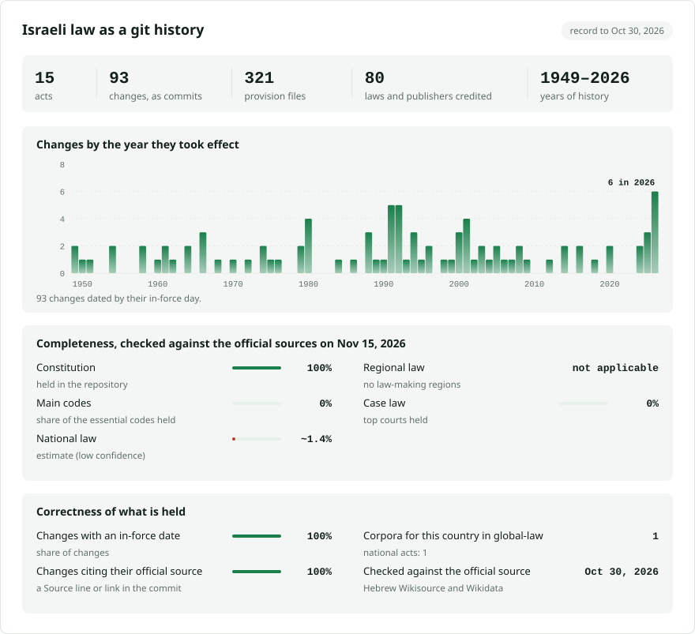

# Israel: law history in git

[עברית](README.md) · **English**

<picture>
<source media="(prefers-color-scheme: dark)" srcset="data/effort-dark.svg">

</picture>

The law of Israel as a git history: one file per provision, one commit per version on the day it took effect, and the act that made each change as the commit's author. `git blame` names the act behind every section; `git log` lists every change to a section; picking a date gives the text in force that day.

Part of [lexifina/global-law](https://github.com/lexifina/global-law), one git history for every country's law: this is Israel's national law, which global-law reads at `israel/national/acts/`.

**What is in it now:** Israeli legislation in Hebrew: the Basic Laws, 925 Knesset laws, 50 ordinances and 46 regulations, orders and other secondary texts in consolidated text with their amendments; 7,657 laws as published in Sefer HaHukim (1949-2026), with the budget laws and 716 ordinances from the Official Gazettes; 559,882 Supreme Court decisions (1996-2022); and, as legislative history, 12,969 Knesset bills and 14,427 plenum and committee transcripts. [`STRUCTURE.md`](STRUCTURE.md) sets out the folders; [`REPRODUCE.md`](REPRODUCE.md) says how the first files were made.

Names are in Hebrew (see [`STRUCTURE.md`](STRUCTURE.md)): legislation in `חקיקה/` (Basic Laws in `חקיקה/חוקי-יסוד/`, laws in `חקיקה/חוקים/<year>/`), laws as published in the Official Gazette in `רשומות/ספר-החוקים/`, and Supreme Court decisions in `פסיקה/בית-המשפט-העליון/<year>/<month>/<day>/`. Each law is a folder with one file per section: `חקיקה/חוקי-יסוד/כבוד-האדם-וחירותו/סעיף-001.md` is section 1 of חוק-יסוד: כבוד האדם וחירותו (Basic Law: Human Dignity and Liberty), and `סעיף-001-א.md` its section 1א. The catalogue is in `קטלוג/`, and the treaties in `אמנות/`, one file per treaty (`אמנות/untc-iv-11.md` is the Convention on the Rights of the Child).

The Basic Laws and the consolidated laws are in Hebrew, as Hebrew Wikisource prints them; there is no official English text, and no translation is part of this record. Catalogue and treaty entries are in English.

## Questions as git commands

| Question | Command |
| --- | --- |
| Every change to section 1 of Basic Law: Human Dignity and Liberty | `git log -p --word-diff -- חקיקה/חוקי-יסוד/כבוד-האדם-וחירותו/סעיף-001.md` |
| Which act wrote each line of section 1? | `git blame חקיקה/חוקי-יסוד/כבוד-האדם-וחירותו/סעיף-001.md` |
| Every version of Basic Law: Human Dignity and Liberty, with the day each took effect | `git log --format="%h %(trailers:key=In-force,valueonly,separator=) %an" -- חקיקה/חוקי-יסוד/כבוד-האדם-וחירותו ":^חקיקה/חוקי-יסוד/כבוד-האדם-וחירותו/README.md"` |
| Section 1 as in force on 1 January 2026 | `python tools/on.py 2026-01-01 חקיקה/חוקי-יסוד/כבוד-האדם-וחירותו סעיף-001` |

Each Basic Law has one version so far (see Dates), so the first three show a single commit.

**Outside git**, we also host this record publicly, for free:

- **[Ask Claude about Israeli law](https://global-law.lexifina.com/v1/try_claude?country=israel)**: opens Claude with a first question ready.
- **[Ask ChatGPT](https://global-law.lexifina.com/v1/try_chatgpt?country=israel)**: the same question in ChatGPT.
- **[Search Israeli law on our site](https://lexifina.com/law?country=israel&q=%D7%9B%D7%91%D7%95%D7%93+%D7%94%D7%90%D7%93%D7%9D)**: a search for "כבוד האדם" (human dignity), with each provision's text and its versions, no account needed.
- **[Developer REST API](https://global-law.lexifina.com/v1/search_law?query=%D7%9B%D7%91%D7%95%D7%93+%D7%94%D7%90%D7%93%D7%9D&jurisdiction=israel)**: the same search as JSON, with no key. See the [documentation here](https://lexifina.com/api/global-law).

Both assistants read the record through the free Global law connector (MCP, `https://global-law.lexifina.com/mcp`); the first time, the chat gives you the link that adds it. Ask in Hebrew or in English.

**Host it yourself easily.** All it takes is git and Python, and the tools run on your machine:

```sh
git clone --depth 1 https://github.com/lexifina/global-law && cd global-law
python3 tools/countries.py add israel/national/acts
python3 tools/law.py show 2026-01-01 israel/national/acts/חקיקה/חוקי-יסוד/כבוד-האדם-וחירותו/סעיף-001.md
```

Opened in Claude Code, Cursor, VS Code or Codex, the clone also starts a local MCP server with the same tools ([MCP.md](https://github.com/lexifina/global-law/blob/main/MCP.md)).

## Dates

Each commit is dated at noon, Asia/Jerusalem, on the day its `In-force:` trailer gives:

- for a Basic Law, the day of the Hebrew Wikisource revision its text was read from (2020 to 2026), not the day the law or its last amendment took effect;
- for a catalogue entry, the publication date Wikidata records for that Basic Law, not checked against Reshumot;
- for a treaty action, the date the UN Treaty Collection gives;
- git cannot store dates before 1970, so the 18 earlier commits are dated 1970-01-01, one second apart, with the real day in `In-force:`. Ask for a date with `tools/on.py`, not `git log --before`.

Each Basic Law's text is credited to the publisher (`Hebrew Wikisource and Wikidata`) as the "oldest version available" (`Kind: publisher`), not to a law, and no amendment is credited yet. Catalogue entries are credited to `Catalogue entry <date>` and treaty actions to the action (`Ratification: Paris Agreement ...`); the committer is Lexifina.

## How it is checked

- `tools/check_repo.py` reads every version back from git on the day it took effect and on the day before and compares it with the corpus, whose hash is in `data/corpus.sha256`: 82 versions of 15 acts, no mismatch.
- It also checks that every commit's trailers parse, that `main` has no merge commits, that no commit date goes backwards and that none is dated after the build.
- `tools/build.py` writes the history from that one corpus file, and the same corpus gives the same commit hashes; [`REPRODUCE.md`](REPRODUCE.md) records the results, and that no second build has been compared yet.
- [vulnerabilities/](vulnerabilities/README.en.md): possible drafting mistakes in this law, found by global-law's detectors and checked by hand. Not run yet.

## What it does not show

- **Amendments.** Each Basic Law is its current text only, not the text as enacted, with no amendment history.
- **The official text.** The text is a third-party copy from Hebrew Wikisource and has not been checked against Reshumot (Sefer HaChukim), the official gazette.
- **Ordinary statutes, regulations and judgments.** None yet.
- **Other Basic Laws.** The temporary State Budget Basic Laws are not included, and the catalogue lacks the replaced 1968 and 1992 versions of Basic Law: The Government.
- **Apparatus.** Editorial notes, chapter headings, signatures and gazette references are left out.
- **Most treaties.** Only the 40 treaties read in the UN Treaty Collection that list Israel, as dated actions without their text; bilateral treaties are not included.

## Sources

| Source | Kind | Past versions | Notes |
| --- | --- | --- | --- |
| [Hebrew Wikisource](https://he.wikisource.org/wiki/%D7%A7%D7%98%D7%92%D7%95%D7%A8%D7%99%D7%94:%D7%97%D7%95%D7%A7%D7%99_%D7%99%D7%A1%D7%95%D7%93) | Third-party copy of the Basic Laws | no, the current text only | Read on 30 October 2026; each page cites the Reshumot publications of the law and its amendments |
| [Wikidata](https://www.wikidata.org/wiki/Q2368137) | Catalogue of the Basic Laws: titles, dates, identifiers | one date per Basic Law | CC0; facts only |
| [UN Treaty Collection](https://treaties.un.org/) | Treaty actions deposited with the UN Secretary-General | every action, with its date | Facts only; no treaty text copied |

## Licence

See [`LICENSE`](LICENSE). No copyright subsists in statutes in Israel (Copyright Act, 5768-2007, section 6), so the Basic Laws' text, copied from Hebrew Wikisource, may be reproduced; the catalogue facts are Wikidata's (CC0) and the treaty actions are facts the UN Treaty Collection records. Lexifina's arrangement, commit messages, tables and tools are dedicated to the public domain under CC0 1.0.

No AI model wrote, translated or corrected legal text; the scripts were written by an AI model (see [`REPRODUCE.md`](REPRODUCE.md)).

## Visualisations

- [visualisations/](visualisations/README.en.md): charts drawn from this repository. Not drawn yet.

## More

From [lexifina/global-law](https://github.com/lexifina/global-law):

- [FEATURES.md](https://github.com/lexifina/global-law/blob/main/FEATURES.md): every feature, and what every corpus must support (`git blame`, `law.py`, the MCP tools)
- [FAQ.md](https://github.com/lexifina/global-law/blob/main/FAQ.md): questions and answers · [CONTRIBUTING.md](https://github.com/lexifina/global-law/blob/main/CONTRIBUTING.md): proposing changes · [MCP.md](https://github.com/lexifina/global-law/blob/main/MCP.md): the MCP server · [REPRODUCE.md](https://github.com/lexifina/global-law/blob/main/REPRODUCE.md): how it was built · [CHANGELOG.md](https://github.com/lexifina/global-law/blob/main/CHANGELOG.md)
- [FRESHNESS.md](https://github.com/lexifina/global-law/blob/main/FRESHNESS.md): how current each corpus is · [Monitoring](https://github.com/lexifina/global-law/tree/main/monitoring): whether updates are running · [WATCHING.md](https://github.com/lexifina/global-law/blob/main/WATCHING.md): how each official source is watched for changes
- [performance/](https://github.com/lexifina/global-law/tree/main/performance): how fast the tools are, measured
- [visualisations/](https://github.com/lexifina/global-law/tree/main/visualisations): charts and bridges across the world's law
- [Vulnerabilities](https://github.com/lexifina/global-law/tree/main/vulnerabilities): mistakes in legislation as published
