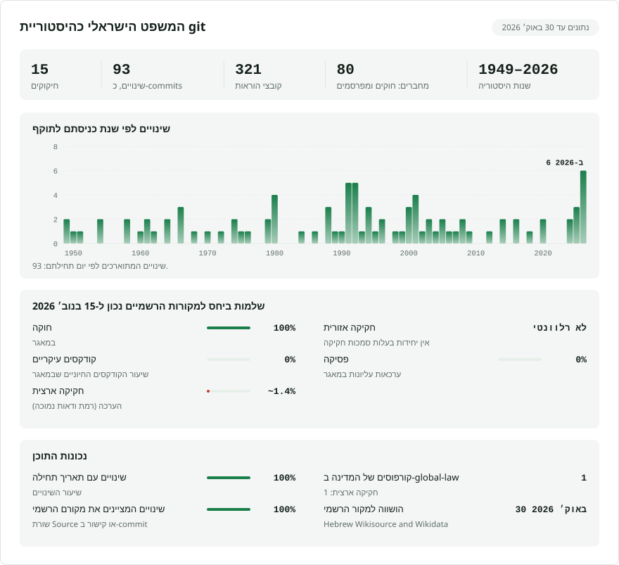

# ישראל: תולדות החקיקה ב-git

**עברית** · [English](README.en.md)

<picture>
<source media="(prefers-color-scheme: dark)" srcset="data/he/effort-dark.svg">

</picture>

דיני מדינת ישראל כהיסטוריית git: קובץ אחד לכל הוראה, קומיט אחד לכל נוסח ביום כניסתו לתוקף, והחיקוק שערך כל שינוי רשום כמחבר הקומיט. `git blame` מציג את החיקוק שמאחורי כל סעיף; `git log` מפרט כל שינוי בסעיף; בחירת תאריך מחזירה את הנוסח שעמד בתוקף באותו יום.

חלק מ-[lexifina/global-law](https://github.com/lexifina/global-law), היסטוריית git אחת לדינים של כל המדינות: זהו הדין הלאומי של ישראל, ש-global-law קורא בנתיב `israel/national/acts/`.

**מה יש כאן כעת:** חקיקה ישראלית בעברית: חוקי היסוד, 925 חוקי כנסת, 50 פקודות ו-46 תקנות, צווים ושאר חקיקת משנה בנוסחם המשולב עם תיקוניהם; 7,657 חוקים כפי שפורסמו בספר החוקים (1949-2026), עם חוקי התקציב ו-716 פקודות מהעיתונים הרשמיים; 559,882 החלטות של בית המשפט העליון (1996-2022); וכהיסטוריה חקיקתית, 12,969 הצעות חוק ו-14,427 פרוטוקולים של מליאת הכנסת ושל ועדותיה. [`STRUCTURE.md`](STRUCTURE.md) מתאר את התיקיות; [`REPRODUCE.md`](REPRODUCE.md) מתאר כיצד נוצרו הקבצים הראשונים.

השמות בעברית (ראו [`STRUCTURE.md`](STRUCTURE.md)): החקיקה ב-`חקיקה/` (חוקי היסוד ב-`חקיקה/חוקי-יסוד/`, החוקים ב-`חקיקה/חוקים/<שנה>/`), החוקים כפי שפורסמו ברשומות ב-`רשומות/ספר-החוקים/`, ופסיקת בית המשפט העליון ב-`פסיקה/בית-המשפט-העליון/<שנה>/<חודש>/<יום>/`. כל חוק הוא תיקייה עם קובץ אחד לכל סעיף: `חקיקה/חוקי-יסוד/כבוד-האדם-וחירותו/סעיף-001.md` הוא סעיף 1 של חוק-יסוד: כבוד האדם וחירותו, ו-`סעיף-001-א.md` הוא סעיף 1א שלו. הקטלוג נמצא ב-`קטלוג/`, והאמנות ב-`אמנות/`, קובץ אחד לכל אמנה (`אמנות/untc-iv-11.md` היא האמנה בדבר זכויות הילד).

חוקי היסוד והחוקים בנוסח משולב הם בעברית, כפי שוויקיטקסט העברי מביא אותם; אין להם נוסח רשמי באנגלית, ותרגום אינו חלק מרשומה זו. רשומות הקטלוג והאמנות הן באנגלית.

## שאלות כפקודות git

| שאלה | פקודה |
| --- | --- |
| כל שינוי בסעיף 1 של חוק-יסוד: כבוד האדם וחירותו | `git log -p --word-diff -- חקיקה/חוקי-יסוד/כבוד-האדם-וחירותו/סעיף-001.md` |
| איזה חיקוק כתב כל שורה בסעיף 1? | `git blame חקיקה/חוקי-יסוד/כבוד-האדם-וחירותו/סעיף-001.md` |
| כל נוסח של חוק-יסוד: כבוד האדם וחירותו, עם יום כניסתו לתוקף של כל אחד | `git log --format="%h %(trailers:key=In-force,valueonly,separator=) %an" -- חקיקה/חוקי-יסוד/כבוד-האדם-וחירותו ":^חקיקה/חוקי-יסוד/כבוד-האדם-וחירותו/README.md"` |
| סעיף 1 כפי שעמד בתוקף ב-1 בינואר 2026 | `python tools/on.py 2026-01-01 חקיקה/חוקי-יסוד/כבוד-האדם-וחירותו סעיף-001` |

לכל חוק יסוד יש עד כה נוסח אחד בלבד (ראו "תאריכים"), ולכן שלוש הפקודות הראשונות מציגות קומיט יחיד.

**מחוץ ל-git**, אנו מארחים את הרשומה הזו גם באופן ציבורי וללא תשלום:

- **[לשאול את Claude על המשפט הישראלי](https://global-law.lexifina.com/v1/try_claude?country=israel)**: פותח את Claude עם שאלה ראשונה מוכנה.
- **[לשאול את ChatGPT](https://global-law.lexifina.com/v1/try_chatgpt?country=israel)**: אותה שאלה ב-ChatGPT.
- **[לחפש במשפט הישראלי באתר שלנו](https://lexifina.com/law?country=israel&q=%D7%9B%D7%91%D7%95%D7%93+%D7%94%D7%90%D7%93%D7%9D)**: חיפוש של "כבוד האדם", עם נוסח כל הוראה והנוסחים שלה, בלי צורך בחשבון.
- **[REST API למפתחים](https://global-law.lexifina.com/v1/search_law?query=%D7%9B%D7%91%D7%95%D7%93+%D7%94%D7%90%D7%93%D7%9D&jurisdiction=israel)**: אותו חיפוש כ-JSON, בלי מפתח. ראו את [התיעוד כאן](https://lexifina.com/api/global-law).

שני העוזרים קוראים את הרשומה דרך המחבר החינמי Global law (MCP, `https://global-law.lexifina.com/mcp`); בפעם הראשונה הצ'אט נותן לכם את הקישור שמוסיף אותו. אפשר לשאול בעברית או באנגלית.

**קל לארח אותו בעצמכם.** כל מה שנדרש הוא git ו-Python, והכלים פועלים במחשב שלכם:

```sh
git clone --depth 1 https://github.com/lexifina/global-law && cd global-law
python3 tools/countries.py add israel/national/acts
python3 tools/law.py show 2026-01-01 israel/national/acts/חקיקה/חוקי-יסוד/כבוד-האדם-וחירותו/סעיף-001.md
```

כשהשכפול נפתח ב-Claude Code, ב-Cursor, ב-VS Code או ב-Codex, הוא מפעיל גם שרת MCP מקומי עם אותם כלים ([MCP.md](https://github.com/lexifina/global-law/blob/main/MCP.md)).

## תאריכים

כל קומיט מתוארך בצהריים, לפי Asia/Jerusalem, ביום שמציין ה-trailer `In-force:` שלו:

- לחוק יסוד, יום גרסת הדף בוויקיטקסט העברי שממנה נקרא הנוסח (2020 עד 2026), ולא היום שבו נכנסו לתוקף החוק או התיקון האחרון שלו;
- לרשומת קטלוג, תאריך הפרסום שוויקינתונים רושם לאותו חוק יסוד, שלא נבדק מול רשומות;
- לפעולה באמנה, התאריך שמציין אוסף האמנות של האו"ם (UN Treaty Collection);
- git אינו יכול לשמור תאריכים שלפני 1970, ולכן 18 הקומיטים המוקדמים יותר מתוארכים 1970-01-01, בהפרש של שנייה זה מזה, והיום האמיתי רשום ב-`In-force:`. בקשו תאריך באמצעות `tools/on.py`, ולא באמצעות `git log --before`.

נוסחו של כל חוק יסוד מיוחס למפרסם (`Hebrew Wikisource and Wikidata`) כ"נוסח המוקדם ביותר הזמין" (oldest version available, `Kind: publisher`), ולא לחוק כלשהו, ואף תיקון אינו מיוחס עדיין. רשומות הקטלוג מיוחסות ל-`Catalogue entry <date>`, והפעולות באמנות לפעולה עצמה (`Ratification: Paris Agreement ...`); המבצע (committer) הוא Lexifina.

## כיצד זה נבדק

- `tools/check_repo.py` קורא כל נוסח בחזרה מ-git ביום כניסתו לתוקף וביום שלפניו, ומשווה אותו לקורפוס, שה-hash שלו נמצא ב-`data/corpus.sha256`: 82 נוסחים של 15 חיקוקים, בלי אי-התאמה.
- הוא בודק גם שה-trailers של כל קומיט ניתנים לפענוח, שאין ב-`main` קומיטי מיזוג, ששום תאריך קומיט אינו חוזר לאחור ושאף קומיט אינו מתוארך לאחר הבנייה.
- `tools/build.py` כותב את ההיסטוריה מאותו קובץ קורפוס יחיד, ואותו קורפוס נותן את אותם hash-ים של קומיטים; [`REPRODUCE.md`](REPRODUCE.md) מתעד את התוצאות, וכן שעדיין לא הושוותה בנייה שנייה.
- [vulnerabilities/](vulnerabilities/): טעויות ניסוח אפשריות בדין זה, שמאתרים הגלאים של global-law ונבדקות ידנית. טרם הורץ.

## מה אינו מוצג כאן

- **תיקונים.** כל חוק יסוד מופיע בנוסחו הנוכחי בלבד, לא בנוסח שבו נחקק, ובלי היסטוריית תיקונים.
- **הנוסח הרשמי.** הנוסח הוא העתק של צד שלישי מוויקיטקסט העברי, ולא נבדק מול רשומות (ספר החוקים), העיתון הרשמי.
- **חוקים רגילים, תקנות ופסקי דין.** אין עדיין.
- **חוקי יסוד אחרים.** חוקי היסוד הזמניים בדבר תקציב המדינה אינם כלולים, ובקטלוג חסרים הנוסחים של חוק-יסוד: הממשלה משנת 1968 ומשנת 1992 שהוחלפו.
- **רכיבים נלווים.** הערות עריכה, כותרות פרקים, חתימות והפניות לרשומות הושמטו.
- **רוב האמנות.** רק 40 האמנות שנקראו באוסף האמנות של האו"ם ושבהן מופיעה ישראל, כפעולות מתוארכות בלי נוסחן; אמנות דו-צדדיות אינן כלולות.

## מקורות

| מקור | סוג | נוסחים קודמים | הערות |
| --- | --- | --- | --- |
| [ויקיטקסט העברי](https://he.wikisource.org/wiki/%D7%A7%D7%98%D7%92%D7%95%D7%A8%D7%99%D7%94:%D7%97%D7%95%D7%A7%D7%99_%D7%99%D7%A1%D7%95%D7%93) | העתק של צד שלישי של חוקי היסוד | לא, הנוסח הנוכחי בלבד | נקרא ב-30 באוקטובר 2026; כל דף מפנה לפרסומים ברשומות של החוק ושל תיקוניו |
| [ויקינתונים](https://www.wikidata.org/wiki/Q2368137) | קטלוג חוקי היסוד: כותרות, תאריכים, מזהים | תאריך אחד לכל חוק יסוד | CC0; עובדות בלבד |
| [אוסף האמנות של האו"ם](https://treaties.un.org/) | פעולות באמנות שהופקדו בידי מזכ"ל האו"ם | כל פעולה, עם תאריכה | עובדות בלבד; לא הועתק נוסח של אמנה |

## רישיון

ראו [`LICENSE`](LICENSE). בישראל אין זכות יוצרים בחיקוקים (חוק זכות יוצרים, התשס"ח-2007, סעיף 6), ולכן מותר לשכפל את נוסח חוקי היסוד, שהועתק מוויקיטקסט העברי; עובדות הקטלוג הן של ויקינתונים (CC0), והפעולות באמנות הן עובדות שרושם אוסף האמנות של האו"ם. הסידור, הודעות הקומיט, הטבלאות והכלים של Lexifina מוקדשים לנחלת הכלל לפי CC0 1.0.

שום מודל בינה מלאכותית לא כתב, תרגם או תיקן נוסח משפטי; הסקריפטים נכתבו על ידי מודל בינה מלאכותית (ראו [`REPRODUCE.md`](REPRODUCE.md)).

טקסט זה הוא תרגום של הגרסה האנגלית ([README.en.md](README.en.md)); במקרה של סתירה, הגרסה האנגלית גוברת.

## תרשימים

- [visualisations/](visualisations/): תרשימים שנבנו ממאגר זה. טרם נבנו.

## מידע נוסף

מתוך המאגר [lexifina/global-law](https://github.com/lexifina/global-law) (דפים באנגלית):

- [FEATURES.md](https://github.com/lexifina/global-law/blob/main/FEATURES.md): כל התכונות, ומה שכל קורפוס חייב לתמוך בו (`git blame`, `law.py`, כלי ה-MCP)
- [FAQ.md](https://github.com/lexifina/global-law/blob/main/FAQ.md): שאלות ותשובות · [CONTRIBUTING.md](https://github.com/lexifina/global-law/blob/main/CONTRIBUTING.md): הצעת שינויים · [MCP.md](https://github.com/lexifina/global-law/blob/main/MCP.md): שרת ה-MCP · [REPRODUCE.md](https://github.com/lexifina/global-law/blob/main/REPRODUCE.md): כיצד נבנה · [CHANGELOG.md](https://github.com/lexifina/global-law/blob/main/CHANGELOG.md)
- [FRESHNESS.md](https://github.com/lexifina/global-law/blob/main/FRESHNESS.md): עד כמה כל קורפוס עדכני · [ניטור](https://github.com/lexifina/global-law/tree/main/monitoring): האם העדכונים פועלים · [WATCHING.md](https://github.com/lexifina/global-law/blob/main/WATCHING.md): כיצד כל מקור רשמי נמצא במעקב אחר שינויים
- [performance/](https://github.com/lexifina/global-law/tree/main/performance): מהירות הכלים, כפי שנמדדה
- [visualisations/](https://github.com/lexifina/global-law/tree/main/visualisations): תרשימים וגשרים בין דיני העולם
- [פרצות](https://github.com/lexifina/global-law/tree/main/vulnerabilities): טעויות בחקיקה כפי שפורסמה
